<div align="center">

# VANTAGE

**See your battlemaps in 3D, straight from the scene you already have.**

A free, open-source module for [Foundry Virtual Tabletop](https://foundryvtt.com) v14.

[](https://foundryvtt.com)
[](https://github.com/Rei-Mods/Vantage/releases/latest)
[](https://github.com/Rei-Mods/Vantage/releases)
[](LICENSE)

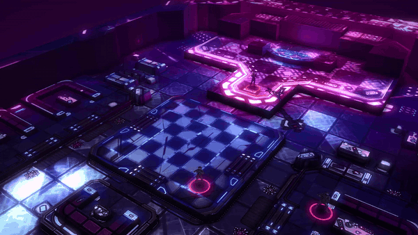

**[▶ Watch the trailer](media/vantage-trailer-720p.mp4)** · [Install](#installation) · [Quick start](#quick-start) · [Features](#features) · [Settings](#settings) · [FAQ](#troubleshooting--faq)

</div>

---

Vantage turns the scene you're already running into a 3D view you can look around in, from a token's eyes or from above. It needs no extra prep. Your map art becomes the floor, walls and doors rise up, Levels become real heights, regions can become crates, daises and pits, and scene lights glow and cast shadows. Tokens stand up as figures. Pick what the walls are made of and a lighting mood (a low sun with long shadows, moonlight, a neon night) so the 3D view fits the map's vibe. When the moment calls for it, send the picture to your players with one click, or go **Live** so their screens follow your camera.

It only draws while the camera moves, so it costs nothing while the window is closed or idle.

<p align="center">
  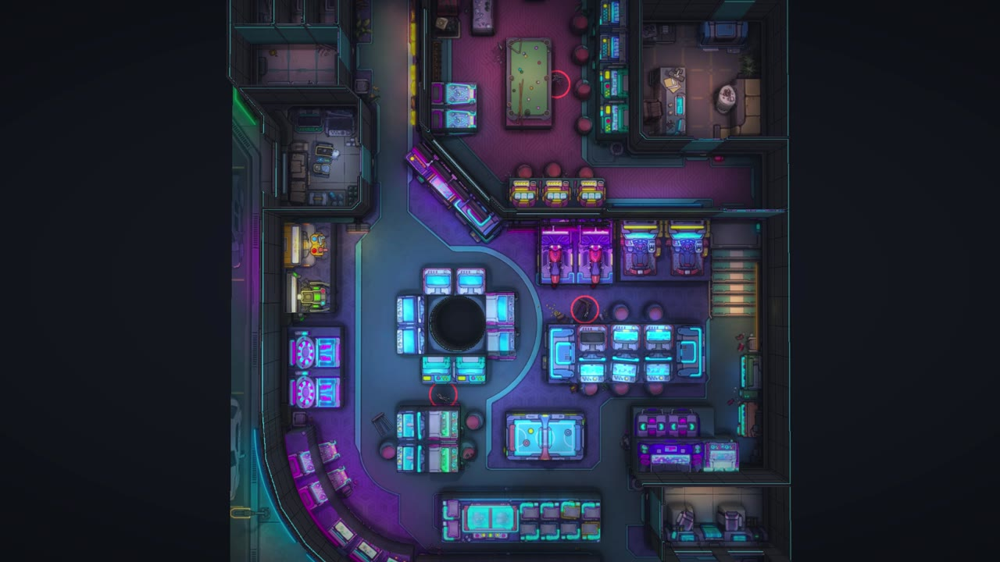
  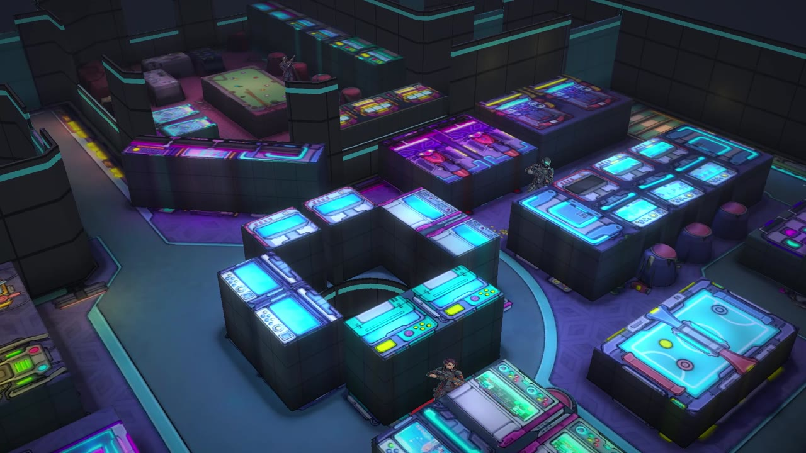
</p>
<p align="center"><sub>The same scene: the flat map you know (left), and Vantage's overview of it (right).</sub></p>

## Features

### See through a token's eyes
- **Eye level from any token.** Right-click a token and press the goggles button. The view looks where the token faces (its rotation, like Foundry's vision cone) and follows it as it moves or turns.
- **Overview mode.** Orbit around the action, with an automatic cutaway that clears walls and upper floors between the camera and your party.
<p align="center">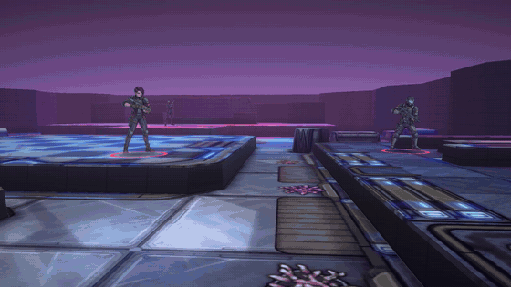</p>

- **Free camera.** Drag to look, WASD to walk, Q/E for down/up, the mouse wheel to zoom, Shift to go faster. Pick whose eyes to look through from a dropdown. Tokens with the same name are numbered, and each entry shows its level.

<p align="center">
  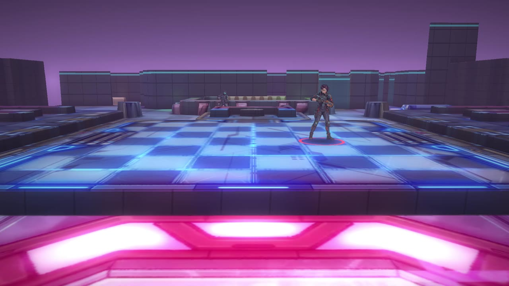
  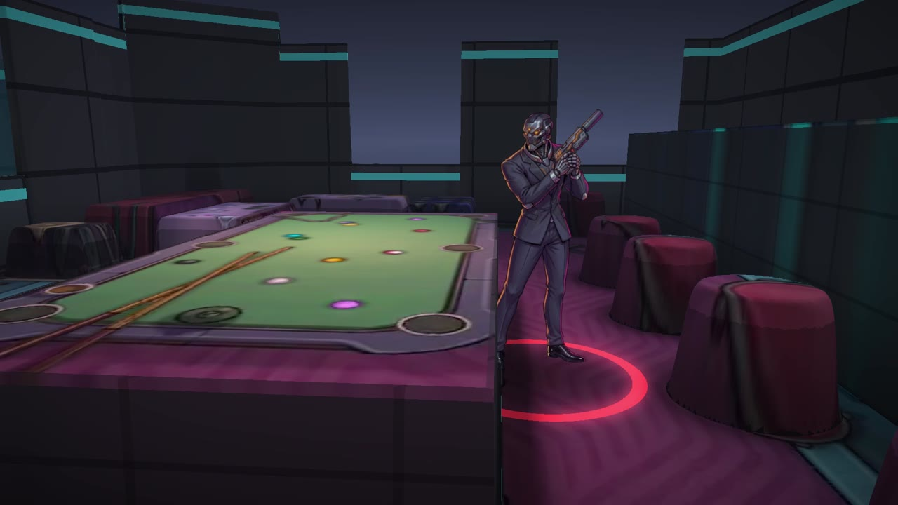
</p>

### Built automatically from your scene
<p align="center">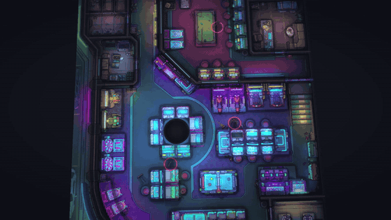</p>
<p align="center"><sub>Everything here comes from the scene's own walls, regions and art (the rise is just for show).</sub></p>

- **Walls and doors rise up.** Sight-blocking walls become 12 ft walls in the [wall skin](#wall-skins-make-the-walls-fit-your-map) you pick, and closed doors become 10 ft doors. Secret doors look like plain wall. Open doors and see-through walls stay open, and windows, glass and foliage (limited sight) become low walls you can see over.
- **Foundry v14 Levels.** Each level's art rises to its elevation. The view shows the token's level plus the levels it can see. A token standing under a higher floor sees the room it's in, not the inside of the floor above.
- **Stairs.** Every Region with a *Change Level* behaviour becomes a staircase between its two floors, with glowing step edges. Ladders (very steep, short regions) stay flat.
- **Rock.** Very dark parts of the map (cave walls, out-of-bounds) can become solid rock. You can turn this off per world or per scene.
- **Lights.** Scene lights glow on walls and floors. Darkness sources don't glow.
- **Live updates.** Moving tokens, opening doors, or editing walls, lights, regions or levels updates the 3D view automatically.

### Wall skins: make the walls fit your map
<p align="center">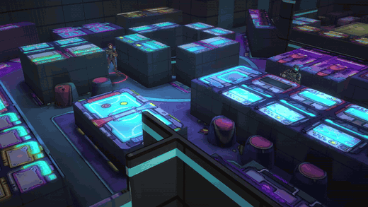</p>

Pick what walls and doors are made of. There are 12 materials:

- **Neon panels**: the default sci-fi look, with a glowing trim.
- **Concrete**, **Riveted steel** (with hazard stripes along the foot) and **Corrugated scrap**.
- **Brick**, **Castle stone**, **Rough rock** (caves and mines) and **Sandstone**.
- **Wooden planks**, **Timber & plaster**, **Marble & gold** and **Hedge**.

You can also pick **Match the map**, which builds the walls from the colours of the floor next to them.

Set a default in the world settings, and give any scene its own skin in **Scene Config → Vantage**. Doors match the skin: wooden doors in brick and stone, a gate in a hedge, hazard stripes on steel. Raised areas use the same material for the natural skins (a stone dais, a wooden counter). With the sci-fi skins they stay plain metal, so consoles still look like consoles.

<p align="center">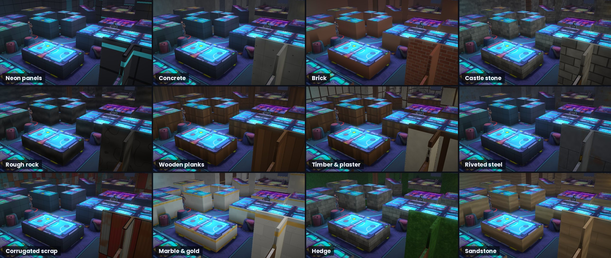</p>

### Lighting moods: match the map's vibe
<p align="center">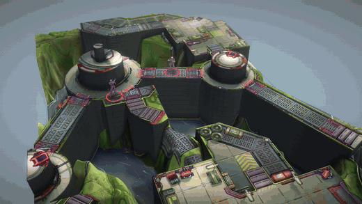</p>

**Automatic** keeps the light that's painted on the map. Or pick a mood for the world, or per scene in **Scene Config → Vantage**:

| Mood | What it looks like |
|---|---|
| Bright sun | Midday light, short crisp shadows, a blue sky |
| Golden hour | A low warm sun, long shadows, an orange sky |
| Overcast | Soft grey daylight with no hard shadows |
| Dusk | The sun just down: pink horizon, purple shade |
| Moonlight | A cool blue night. The map's lamps and screens keep glowing |
| Neon night | Dark with a magenta haze. Scene lights and painted neon blaze |
| Torchlit | Underground: dark and warm, the haze close in, scene lights carry the room |
| Toxic haze | Sickly green light and thick haze |
| Blood moon | A red moon over everything |

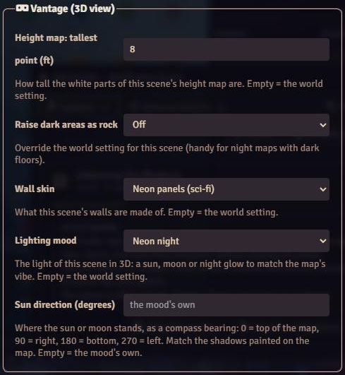

With *Shadows* on Full, the sun or moon casts real shadows from walls, raised areas and terrain, and figures stand in the light or in the shade. Set **Sun direction** for a scene so the shadows fall the same way as the ones painted on the map. Changing the mood is instant (no rebuild), and players watching *Live* see it too.

<br clear="right">

<p align="center">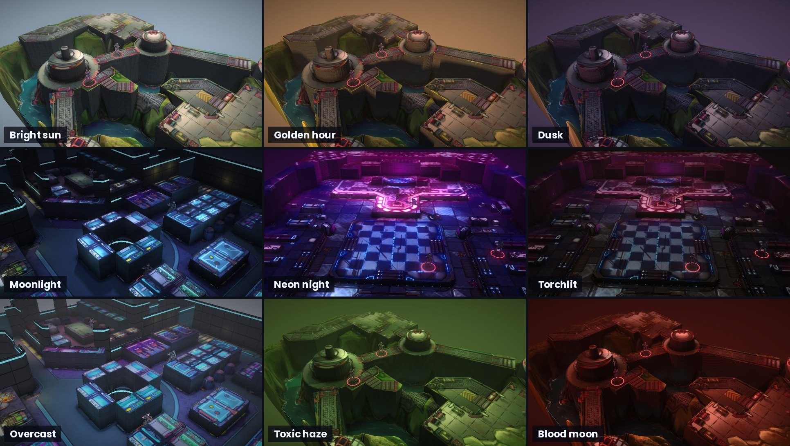</p>

### Raised areas: crates, consoles, daises and pits
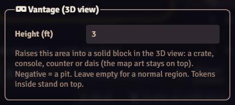

Open any **Region → Placement → Vantage (3D view) → Height (ft)**. The region becomes a solid block that tall, with the map art staying on top. A negative height digs a pit. Tokens inside stand on top of the block, or at the bottom of the pit. To make a crate, draw a rectangle over a painted one and set Height 4.

<p align="center">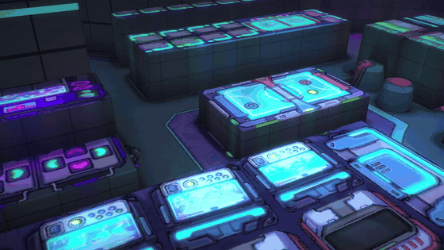</p>

<br clear="right">

### Height maps: hills, rubble and riverbanks
Put a grey image next to a map, named like the map plus `_height`, for example `Canyon.webp` → `Canyon_height.webp` (`.png` and `.jpg` work too). White is the tallest point and black is flat floor. Tokens stand on the slopes. Set the tallest point in the world settings, or per scene in **Scene Config → Vantage**.

<p align="center">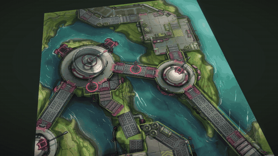</p>

### Figures stand up
- Each token stands up as a cut-out of its actor's **portrait**, with a coloured base ring: red for hostile, cyan for friendly, yellow for neutral, purple for secret.
- **Top-down token art?** Use *Token image, leaning back*. The card tilts back by the angle the art was drawn from, so the figure stands instead of tipping toward you.
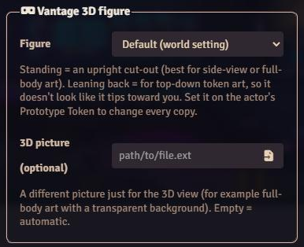

- **Per token:** in **Token Config → Appearance → Vantage 3D figure**, choose Portrait, Token standing, Token leaning back, Lying flat or Don't show, plus an optional separate 3D picture (for example full-body art). Set it on the actor's **Prototype Token** to change every copy.
- Objects (in dnd5e, creature type *Object*; in any system, the `vantage.flat` flag) lie flat on the floor like on the map. Item Piles loot is drawn small, on the floor. Figures right next to the camera fade so they don't fill the screen.

<p align="center">
  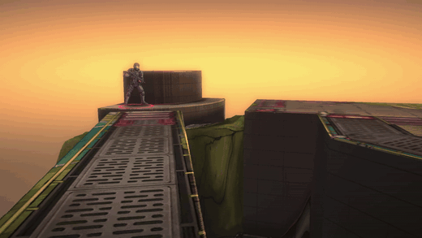
  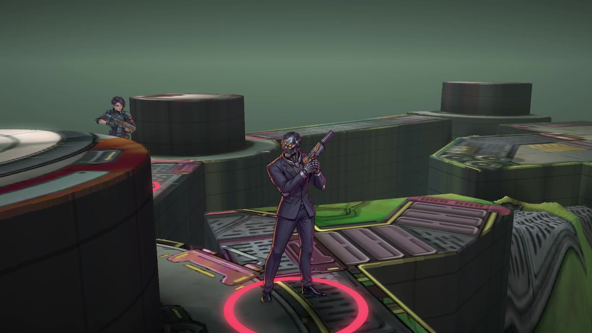
</p>

<br clear="right">

### Shadows, corner shading and glow
The 4 nearest lights cast soft shadows from walls, rock and raised areas. Floors darken softly in corners and next to walls and crates. Bright lights and trims bloom. The haze takes on the map's own colours, so a club fades to purple and a river canyon to teal.

<p align="center">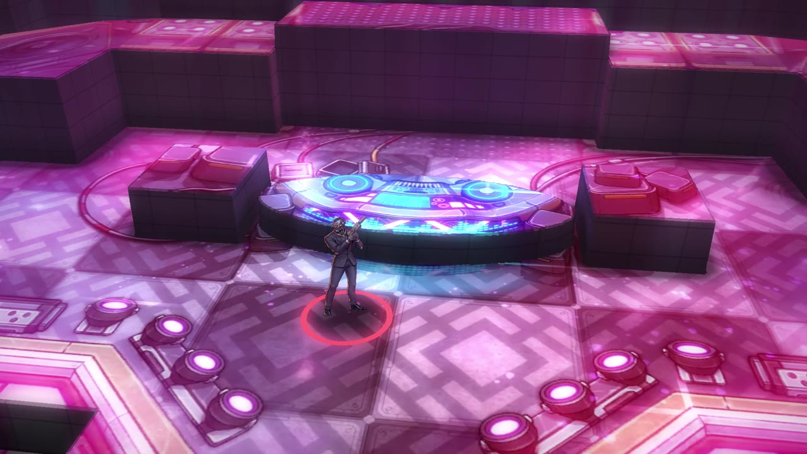</p>

### Show your players
- **Show Players** sends the current picture to everyone, and also works on phones. Hidden tokens are never in it.
- **Live** makes your players' screens follow your camera while you move it. Phones get a fresh picture whenever you stop moving.
- Optionally, let players open the view from their own tokens.

### Light on performance
- **Nothing runs while the window is closed.** While it's open, it only draws when the camera moves.
- Choose a resolution per computer (Full / Balanced / Fast). Optionally drop to half resolution while moving, for slower machines.
- The last 2 built levels are remembered, so switching between tokens on different floors is instant after the first time.
- No libraries and no build step: it's plain WebGL2 (a height-field ray-marcher) in about 2,200 lines of JavaScript.

## Installation

**In Foundry:** *Add-on Modules → Install Module*, paste this manifest URL into the box at the bottom, and press *Install*.

```
https://github.com/Rei-Mods/Vantage/releases/latest/download/module.json
```

Then, in your world, open *Game Settings → Manage Modules*, tick **Vantage**, and save.

**By hand:** download `vantage.zip` from the [latest release](https://github.com/Rei-Mods/Vantage/releases/latest) and unzip it into `Data/modules/vantage`.

**Requirements:** Foundry VTT v14 and a browser with WebGL2 (every current desktop browser, and the Foundry app). Vantage works with any game system. Item Piles, Tokenizer and Visage are recognised when present, but none are needed.

## Quick start

1. **Open a scene** that has walls. Most premium maps with Foundry walls look great straight away.
2. **Right-click a token → the goggles button** (left column) to see from its eyes. Or use the **Tokens toolbar → goggles** for an overview of the whole scene.
3. **Drag** to look around, **WASD** to move, and press **Show Players** or **Live** when you want the table to see it.

To make a map pop even more, give the obvious props a height (*Region → Placement → Height*), and add a height map for outdoor terrain.

## Using Vantage

### Camera controls
*Click the 3D picture first.*

| Input | Eye view | Overview |
|---|---|---|
| Drag | Look around | Orbit |
| Right-drag | Slide sideways | Slide sideways |
| W A S D / arrows | Walk | Pan |
| Q / E | Down / up | Turn |
| Mouse wheel | Field of view | Distance |
| Shift | Faster | Faster |

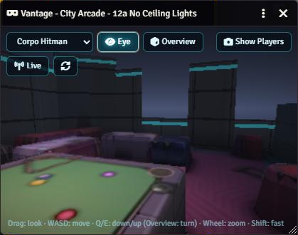

The toolbar has **Eye** and **Overview** to switch camera, a dropdown to choose whose eyes to look through, **Show Players**, **Live**, and **Rebuild** (for big scene edits; most edits update by themselves).

<br clear="right">

### Making maps look great
| You want | Do this |
|---|---|
| Walls that stand up | Ordinary sight-blocking walls (they're already there on most maps). |
| A low wall, railing, window or hedge | Limited / proximity / distance sight walls become 4 ft walls. |
| Multiple floors | v14 Levels, one per floor, each with its own art and elevation. |
| Stairs or a ramp between floors | A Region with a *Change Level* behaviour joining the two levels. |
| Crates, consoles, counters, a stage | A Region with *Vantage → Height* set (e.g. 3–4 ft). |
| A pit, a pool, a sunken floor | A Region with a negative height. |
| Hills, dunes, rubble, riverbanks | A `<map>_height` image next to the map art. |
| A night map whose floor is very dark | Turn *Raise dark areas as rock* off (world, or per scene). |
| Walls that suit a fantasy, modern or wasteland map | A *Wall skin*: castle stone, brick, wood, concrete, scrap… (world, or per scene). |
| A sunset, a night, a neon club, a torchlit dungeon | A *Lighting mood* in *Scene Config → Vantage*. Set *Sun direction* to match the map's painted shadows. |

### Making a height map
Any image editor works: paint the floor black, then paint hills and mounds in lighter greys with soft brushes, and the tallest parts white. You can also ask an image generator to convert the map. This prompt works well (attach the map):

> Turn this battlemap into a grayscale height map for a 3D view. Keep exactly the same framing, size and layout as the attached image. Pure black = flat floor. Brighter = taller: rubble piles, rocks, crates, hills and raised ground in light grey to white, the tallest things pure white. Smooth soft gradients on slopes and mounds, hard edges only on sheer drops. Walls, doors and furniture outlines stay black (they are built separately). No colours, no shading from lights, no shadows, no texture detail, no text, no grid lines.

Save it next to the map with `_height` added to the name. Walls, doors, stairs and raised areas always win over the height map.

## Settings

### World settings (GM)
| Setting | Default | What it does |
|---|---|---|
| Wall height (ft) | 12 | How tall sight-blocking walls are. |
| Door height (ft) | 10 | How tall closed doors are. |
| Raise dark areas as rock | On | Very dark map areas become solid rock. |
| Rock height (ft above the floor) | 35 | How tall that rock is. |
| How dark counts as rock | 26 | Brightness 0–255. Higher = more rock. |
| Glow trim colour | `#3ce6ff` | The glowing strip along wall tops (Neon panels skin) and stair edges. |
| Wall skin | Neon panels | What walls and doors are made of (12 materials, or Match the map). |
| Lighting mood | Automatic | The light: the map's own, or a sun, moon or night mood. |
| Haze distance (ft) | 250 | Smaller = foggier. |
| Glow (bloom) | On | Bright lights and trims bleed a soft glow. |
| Snapshot width (px) | 1600 | Size of the picture sent with Show Players. |
| Figure pictures | Portrait | Portrait / Token image standing / Token image leaning back. |
| Leaning figures: angle | 40 | Tilt for leaning figures: about 30–45 for high-angle token art, 60–70 for straight-down art. |
| Height maps: tallest point (ft) | 10 | How tall white is in height maps. 0 = off. |
| Players can open the 3D view | Off | Players can open it from their own tokens (it shows only tokens they can see, but ignores fog of war). |

### Client settings (each computer)
| Setting | Default | What it does |
|---|---|---|
| Shadows + corner shading | Full | Full / Corner shading only / Off. |
| 3D view resolution | Balanced | Full / Balanced / Fast. |
| Lower resolution while moving | On | Half resolution while the camera moves (smooth on slow computers, slightly blurry while moving). Turn off for an always-sharp picture. |

### Per scene, region and token
| Where | Field | Flag |
|---|---|---|
| Scene Config → Vantage | Height map: tallest point (ft); Raise dark areas as rock; Wall skin; Lighting mood; Sun direction (degrees, 0 = top of the map) | `flags.vantage.heightMax`, `flags.vantage.raiseDark`, `flags.vantage.wallSkin`, `flags.vantage.mood`, `flags.vantage.sunAz` |
| Region Config → Placement → Vantage | Height (ft), negative = pit | `flags.vantage.raise` |
| Token / Prototype Token Config → Appearance → Vantage 3D figure | Figure, 3D picture | `flags.vantage.figure`, `flags.vantage.standee` |
| (token or actor flag) | Lie flat like an object | `flags.vantage.flat` |

## API

```js
const vantage = game.modules.get("vantage").api;

vantage.open("Goblin Boss");          // eye level from a token (Token, TokenDocument, id or name)
vantage.open(token, "orbit");         // overview around a token
vantage.overview();                   // overview of the whole scene
vantage.showPlayers();                // send the current picture to every player
vantage.window();                     // the open 3D window, or null
vantage.sendImage(url, "Title");      // show any image to every player in the viewer

Hooks.once("vantageReady", api => { /* the API is ready */ });
```

## Performance

Vantage draws one full-screen ray-march per frame, and only while the camera moves. On a mid-range desktop GPU, a 1080p frame with shadows takes about 2 ms. Building a scene takes 1–7 seconds the first time, depending on its size. The last two built levels are kept, so switching back is instant. Nothing runs while the window is closed.

On slow laptops: set *3D view resolution* to **Fast**, keep *Lower resolution while moving* on, and use *Shadows + corner shading: Corner shading only*.

## Troubleshooting & FAQ

<details><summary><b>Everything is grey, or "Vantage needs WebGL2"</b></summary>

Your browser has hardware acceleration turned off, or doesn't support WebGL2. Turn on *Use hardware acceleration* in the browser settings and restart it. If the window reports that the graphics context was lost, close it and open it again.
</details>

<details><summary><b>Half the map turned into black rock</b></summary>

It's a night map with very dark floors. Turn off *Raise dark areas as rock*, either in the world settings or for just this scene in *Scene Config → Vantage*.
</details>

<details><summary><b>Figures look like they're tipping toward me</b></summary>

Your token art is drawn from above. Use the actor's upright portrait (the default), or set *Figure pictures* (or the token's *3D figure*) to **Token image, leaning back**, and adjust *Leaning figures: angle*.
</details>

<details><summary><b>A figure is cut off at the knees</b></summary>

Its picture is half-body art. Give the token a full-body *3D picture* in *Token Config → Appearance → Vantage 3D figure*.
</details>

<details><summary><b>Can players see things they shouldn't?</b></summary>

Hidden tokens are never shown to players. Players who open the view themselves (if you allow it) see only the tokens they can see, but the 3D view ignores fog of war.
</details>

<details><summary><b>The walls look sci-fi on my fantasy map</b></summary>

Pick a *Wall skin* that fits, such as Castle stone, Brick, Wooden planks or Timber & plaster, in the world settings or for just this scene in *Scene Config → Vantage*.
</details>

<details><summary><b>The shadows fall the wrong way for my map</b></summary>

Set *Sun direction* in *Scene Config → Vantage* to where the light comes from on the map (0 = top, 90 = right, 180 = bottom, 270 = left).
</details>

<details><summary><b>The picture is blurry while I move</b></summary>

That's *Lower resolution while moving*. Turn it off in *Configure Settings* (it's a setting for each computer).
</details>

## Contributing

Bug reports and ideas are very welcome. Please [open an issue](https://github.com/Rei-Mods/Vantage/issues/new/choose) with a screenshot of the 3D view and the same spot on the map. Pull requests are welcome too; see [CONTRIBUTING.md](CONTRIBUTING.md).

## License & credits

Vantage is released under the [MIT License](LICENSE).

**Battlemaps in the screenshots and trailer are by [Czepeku](https://www.czepeku.com)** (Cyberpunk Club, Canyon River Base and City Arcade). They are shown here with credit, and they're not part of this module or this repository. Get them from Czepeku.
